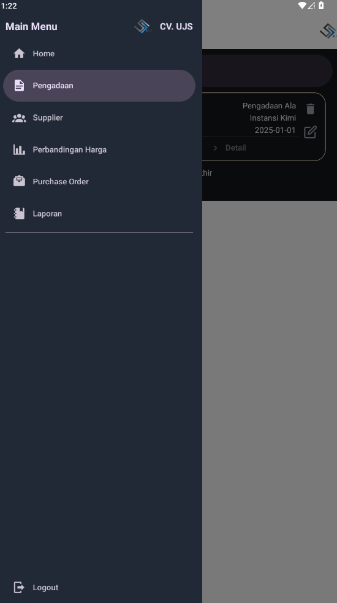
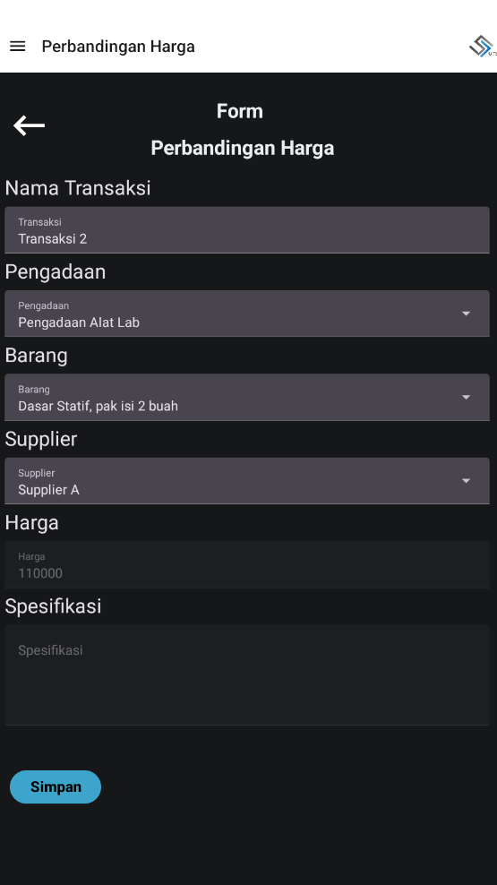
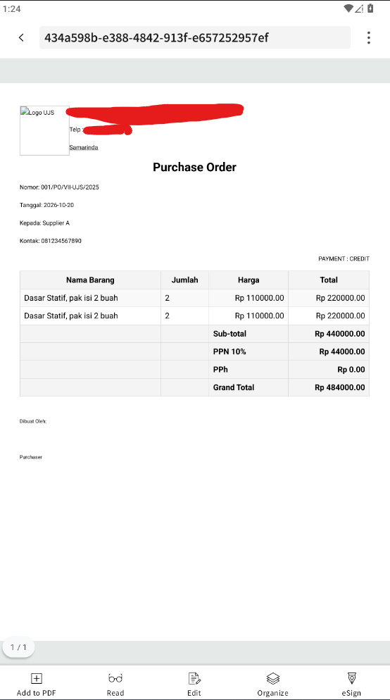
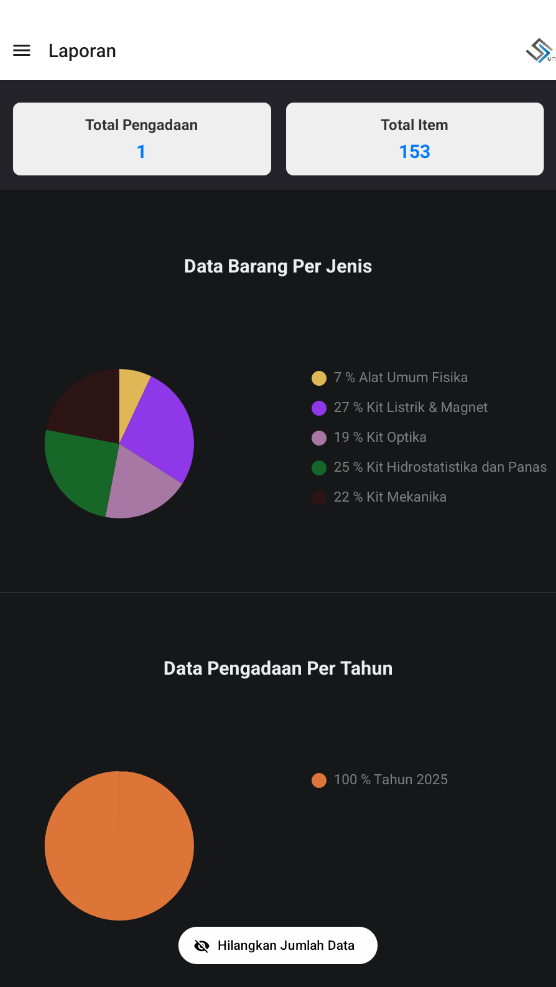

<p align="center">
  
</p>

<h1 align="center">CV UJS — Sistem Pengadaan Barang</h1>

Aplikasi mobile untuk mengelola proses **pengadaan barang**: mencatat supplier, membandingkan harga antar supplier, membuat **Purchase Order** (ekspor PDF), dan melihat laporan ringkas. Dibangun dengan **React Native (Expo)**.

## Fitur

- **Pengadaan** — kelola daftar pengadaan barang beserta detailnya
- **Supplier** — data supplier dan kontaknya
- **Perbandingan Harga** — bandingkan harga satu barang dari beberapa supplier
- **Purchase Order** — buat PO dan ekspor ke PDF (otomatis hitung sub-total, PPN, grand total)
- **Laporan** — ringkasan total pengadaan & item, grafik barang per jenis dan pengadaan per tahun

## Teknologi

React Native · Expo · Expo Router · TypeScript · React Native Paper

## Tangkapan Layar

| Beranda | Menu | Perbandingan Harga |
|---|---|---|
|  |  |  |

| Purchase Order (PDF) | Laporan |
|---|---|
|  |  |

## Menjalankan di lokal

```bash
git clone https://github.com/Axcels81/cv-ujs.git
cd cv-ujs
npm install
npx expo start
```

Pindai QR code dengan aplikasi **Expo Go** (Android/iOS), atau tekan `a` untuk membuka di emulator Android.

**Login demo:** username `admin`, password `admin`.

> Catatan: aplikasi ini berjalan dengan data contoh (statis) tanpa backend. Identitas pada kop Purchase Order memakai alamat placeholder.

---
Dibuat oleh **Ahmad Hadi Sahab** · [Portofolio](https://axcels81.github.io)
